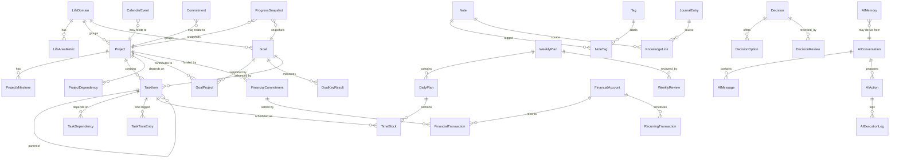

# Life OS — Database Design

SQL Server, EF Core Code First, explicit configurations. Migrations only — never `EnsureCreated()`.

## 1. Conventions

| Concern | Decision |
|---|---|
| Primary keys | `uniqueidentifier`, generated in domain via `Guid.CreateVersion7()` (time-ordered, index friendly) |
| Timestamps | `datetimeoffset(0)`, always UTC. Display converts to configured timezone. |
| Dates (calendar days) | `date` (`DateOnly`) — due dates, plan dates, transaction dates |
| Money | `decimal(18,2)`; currency always stored alongside as `char(3)` ISO code |
| Percentages | `decimal(5,2)` in 0..100 |
| Hours | `decimal(9,2)` |
| Concurrency | `rowversion` on mutable aggregate roots |
| Delete behavior | `Restrict`/`NoAction` for history, finance, audit, decisions. `Cascade` only for strictly owned children (milestones, key results, options, messages, time entries). |
| Soft delete | `IsArchived` on `Project`; `IsActive` on `LifeDomain`, `FinancialAccount`, `RecurringTransaction`, `AIMemory` |
| Strings | `nvarchar` with explicit max lengths; no `nvarchar(max)` except note/journal/AI content |

## 2. ERD



## 3. Tables, keys, indexes, delete behavior

### System

**AppSettings** — `Id` PK, `Key` UQ, `Value`, `ValueType`, `Description`, `IsSensitive`, timestamps.
Sensitive values are encrypted at rest by `ISecretProtector` (DPAPI on Windows) before storage.

**Attachments** — `Id` PK, `Checksum` IX, `RelativePath` UQ. Files live on disk under
`Storage:AttachmentsRoot`; only metadata in SQL.

**AuditLogs** — `Id` PK, `(EntityType, EntityId)` IX, `CreatedAtUtc` IX. `NoAction` everywhere.

**BackupHistory** — `Id` PK, `CreatedAtUtc` IX.

### Life domains

**LifeDomains** — `Id` PK, `Name` UQ, `SortOrder` IX, `RowVersion`.
**LifeAreaMetrics** — `Id` PK, `LifeDomainId` FK → `LifeDomains` **Cascade** (owned child),
`(LifeDomainId, Name)` UQ.

### Projects

**Projects** — `Id` PK, `LifeDomainId` FK → `LifeDomains` **SetNull**, `RowVersion`,
IX `(Status, IsArchived)`, IX `(LifeDomainId)`, IX `(TargetEndDate)`.
**ProjectMilestones** — `Id` PK, `ProjectId` FK **Cascade**, IX `(ProjectId, SortOrder)`.
**ProjectDependencies** — `Id` PK, `ProjectId` FK **Cascade**, `DependsOnProjectId` FK **NoAction**,
UQ `(ProjectId, DependsOnProjectId)`, CHECK `ProjectId <> DependsOnProjectId`.
**GoalProjects** — composite PK `(GoalId, ProjectId)`, both FKs **Cascade**, `ContributionWeight`.

### Goals

**Goals** — `Id` PK, `LifeDomainId` FK **SetNull**, `RowVersion`, IX `(Status, TargetDate)`.
**GoalKeyResults** — `Id` PK, `GoalId` FK **Cascade**, IX `(GoalId)`.

### Execution

**Tasks** (entity `TaskItem`) — `Id` PK, `ProjectId` FK **SetNull**, `GoalId` FK **SetNull**,
`ParentTaskId` FK **NoAction**, `RowVersion`,
IX `(Status, DueDate)`, IX `(Status, ScheduledDate)`, IX `(ProjectId)`, IX `(GoalId)`,
filtered IX `IsNextAction = 1`.
**TaskDependencies** — `Id` PK, both FKs **NoAction**, UQ `(TaskId, DependsOnTaskId)`,
CHECK `TaskId <> DependsOnTaskId`.
**TaskTimeEntries** — `Id` PK, `TaskId` FK **Cascade**, IX `(TaskId, StartedAtUtc)`.

### Planning

**WeeklyPlans** — `Id` PK, `WeekStartDate` UQ, `RowVersion`.
**DailyPlans** — `Id` PK, `WeeklyPlanId` FK **Cascade**, UQ `(WeeklyPlanId, PlanDate)`.
**TimeBlocks** — `Id` PK, `DailyPlanId` FK **Cascade**, `TaskId` FK **SetNull**,
`CalendarEventId` FK **SetNull**, IX `(StartAtUtc)`, CHECK `EndAtUtc > StartAtUtc`.

### Finance

**FinancialAccounts** — `Id` PK, `Name` UQ, `RowVersion`.
**FinancialTransactions** — `Id` PK, `FinancialAccountId` FK **Restrict**,
`RelatedCommitmentId` FK **SetNull**, IX `(TransactionDate)`, IX `(FinancialAccountId, TransactionDate)`,
IX `(IsForecast, TransactionDate)`.
**RecurringTransactions** — `Id` PK, `FinancialAccountId` FK **Restrict**, IX `(NextOccurrenceDate)`.
**FinancialCommitments** — `Id` PK, `RelatedProjectId` FK **SetNull**, `RowVersion`, IX `(NextDueDate, Status)`.
**Budgets** — `Id` PK, IX `(Category, StartDate)`.

### Knowledge

**Notes** — `Id` PK, IX `(IsPinned, UpdatedAtUtc)`, full-text index on `(Title, Content)`.
**JournalEntries** — `Id` PK, `EntryDate` UQ, IX `(EntryDate)`.
**Tags** — `Id` PK, `Name` UQ.
**NoteTags** — composite PK `(NoteId, TagId)`, both **Cascade**.
**KnowledgeLinks** — `Id` PK, IX `(SourceEntityType, SourceEntityId)`,
IX `(TargetEntityType, TargetEntityId)`, UQ on the full tuple.

### Decisions

**Decisions** — `Id` PK, `RowVersion`, IX `(Status, ReviewDate)`.
**DecisionOptions** — `Id` PK, `DecisionId` FK **Cascade**.
**DecisionReviews** — `Id` PK, `DecisionId` FK **Restrict** (history preserved).

### Calendar

**CalendarEvents** — `Id` PK, IX `(StartAtUtc)`, `RelatedProjectId`/`RelatedGoalId` FK **SetNull**,
CHECK `EndAtUtc > StartAtUtc`.
**Commitments** — `Id` PK, IX `(DueDate, Status)`, `RelatedProjectId`/`RelatedTaskId` FK **SetNull**.

### Analytics

**ProgressSnapshots** — `Id` PK, IX `(EntityType, EntityId, SnapshotDate)`.
**WeeklyReviews** — `Id` PK, `WeeklyPlanId` FK **Restrict**, UQ `(WeeklyPlanId)`.

### AI

**AIConversations** — `Id` PK, IX `(UpdatedAtUtc)`, IX `(RelatedEntityType, RelatedEntityId)`.
**AIMessages** — `Id` PK, `ConversationId` FK **Cascade**, IX `(ConversationId, CreatedAtUtc)`.
**AIMemories** — `Id` PK, IX `(MemoryType, IsActive)`, IX `(SourceEntityType, SourceEntityId)`.
**AIInsights** — `Id` PK, IX `(Status, ExpiresAtUtc)`.
**AIActions** — `Id` PK, `ConversationId` FK **SetNull**, `IdempotencyKey` UQ,
IX `(Status, CreatedAtUtc)`, `RowVersion`.
**AIExecutionLogs** — `Id` PK, `AIActionId` FK **Cascade**, IX `(AIActionId, StartedAtUtc)`.

## 4. Constraints enforced in the database

- `CK_ProjectDependencies_NoSelf`
- `CK_TaskDependencies_NoSelf`
- `CK_TimeBlocks_ValidRange`
- `CK_CalendarEvents_ValidRange`
- `CK_GoalKeyResults_Weight` (0 < Weight <= 100)
- `CK_FinancialTransactions_AmountPositive`
- `CK_FinancialCommitments_Installments` (PaidInstallments <= InstallmentCount)
- `CK_Goals_ProgressRange`, `CK_Projects_ProgressRange` (0..100)

Circular dependency chains are rejected in the Application layer (`DependencyGraphGuard`),
because SQL Server cannot express transitive constraints. The guard is unit-tested.

## 5. Concurrency

`rowversion` on aggregate roots. `DbUpdateConcurrencyException` is translated to a
`ConflictResult` and surfaced in the UI as "این رکورد توسط عملیات دیگری تغییر کرده است".
AI execution re-reads and re-validates before writing, so a stale proposal fails loudly
instead of overwriting newer data.

## 6. Financial precision

- All money is `decimal(18,2)`. `float`/`double` are banned in finance code paths.
- Currency is explicit on every monetary row. No implicit conversion anywhere.
- IRR vs IRT is a first-class setting (`Finance:CurrencyConvention`). The formatter renders
  the configured convention and never silently divides by 10.
- Actual (`IsForecast = false`) and forecast (`IsForecast = true`) rows are separate records.
  Forecast queries always return the assumption list alongside the numbers.

## 7. Timestamp convention

- Storage: `DateTimeOffset` in UTC (`datetimeoffset(0)`).
- `DateOnly` for calendar-day concepts (due dates, plan dates, transaction dates).
- Conversion to Jalali + local timezone happens only in `LifeOS.Web/Services/Formatting`.
- `TimeProvider` is the single source of "now".

## 8. Applying migrations

```powershell
dotnet ef migrations add InitialCreate `
  --project src/LifeOS.Infrastructure `
  --startup-project src/LifeOS.Web `
  --output-dir Persistence/Migrations

dotnet ef database update `
  --project src/LifeOS.Infrastructure `
  --startup-project src/LifeOS.Web
```

The app also applies pending migrations at startup in Development only, guarded by
`Database:ApplyMigrationsOnStartup`.
